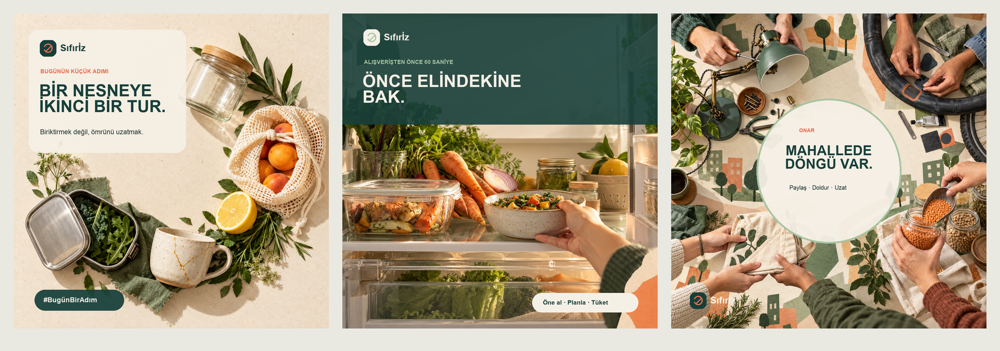

# Sıfırİz - Atıksız Şehir Yaşamı İçerik Kampanyası

<p align="center">
  <strong>Atıksız yaşamı kusursuzluk baskısından çıkarıp şehir hayatına sığan küçük alışkanlıklara dönüştüren yapay zekâ destekli içerik markası.</strong>
</p>

<p align="center">
  <a href="https://www.canva.com/design/DAHYRxgDzsM/ZDR7nOSgXa-FAXGKgQorxA/view?utm_content=DAHYRxgDzsM&utm_campaign=designshare&utm_medium=link2&utm_source=uniquelinks&utlId=hdc8101f067"></a>
  
  
</p>



## Projenin fikri

Sıfırİz; gündelik şehir yaşamında uygulanabilir, yargılamayan ve kanıta dayalı içeriklerle davranış değişikliğini destekleyen kurgusal bir markadır. Proje yalnızca son içerikleri değil; strateji, üretim, kalite kontrolü, etik değerlendirme ve yayın planını birlikte sunar.

## Teslim kapsamı

- Marka analizi ve beş benzer oluşum değerlendirmesi
- Marka kimliği, görsel dil ve marka sesi rehberi
- Neden-Kime-Ne-Nasıl çerçevesi ve hedef persona
- Dört içerik sütunu
- SEO uyumlu blog yazısı
- RTF formülüyle üç sosyal medya gönderisi
- Üç özgün yapay zekâ görseli
- 18 saniyelik dikey tanıtım videosu ve TTS seslendirme
- 7 günlük içerik takvimi
- Telif, etik, marka sesi ve halüsinasyon kontrol kaydı
- Prompt kütüphanesi, AI kullanım raporu ve otomasyon taslağı

## İncelemeye buradan başlayın

1. [Canva sunumu](https://www.canva.com/design/DAHYRxgDzsM/ZDR7nOSgXa-FAXGKgQorxA/view?utm_content=DAHYRxgDzsM&utm_campaign=designshare&utm_medium=link2&utm_source=uniquelinks&utlId=hdc8101f067)
2. `deliverables/SifirIz-Ornek-Icerik-Portfolyosu.pdf`: sekiz sayfalık jüri özeti
3. `deliverables/SifirIz-Marka-Stratejisi.docx`: marka stratejisi
4. `deliverables/SifirIz-7-Gunluk-Icerik-Takvimi.xlsx`: formüllü yayın takvimi
5. `video/SifirIz-18sn-Tanitim.mp4` ve `audio/SifirIz-TTS-Seslendirme.m4a`

Mac'te `PORTFOLYOYU-AC.command` dosyasına çift tıklayarak ana portföy PDF'ini açabilirsiniz. Bu bir içerik üretimi portföyüdür; sunucu veya terminal kurulumu gerektirmez.

## Dosya yapısı

```text
assets/       Kampanya görselleri ve marka kartı
audio/        TTS seslendirme
content/      Blog, sosyal gönderiler ve senaryolar
deliverables/ Strateji, takvim ve portföy dosyaları
docs/         Promptlar, kontrol kayıtları ve kullanım notları
video/        Dikey tanıtım videosu ve altyazı
```

## Kalite ve sorumlu yapay zekâ

- Portföyün sekiz sayfası taşma ve kesilme açısından görsel olarak kontrol edildi.
- Takvimdeki formüller yeniden hesaplandı ve doğrulandı.
- Video H.264/AAC, 1080 × 1920 ve 18 saniye olarak doğrulandı.
- Yapay zekâ görsellerinde yaşayan sanatçı veya marka stili taklit edilmedi.
- Teknik ve istatistiksel iddialar kaynaklandırıldı; doğrulanamayan iddialar çıkarıldı.
- Gerçek kişilerin kimlikleri kullanılmadı.

## Kaynaklar

- [Sıfır Atık Nedir?](https://www.sifiratik.gov.tr/sifir-atik/sifir-atik-nedir)
- [UNEP Zero Waste 101](https://www.unep.org/interactives/zero-waste-101/index.html)
- [WWF-Türkiye Sahil Sahiplen](https://www.wwf.org.tr/?15760%2Fsahilsahiplenprogramsonuclar2023-2024=)
- [Fazla Gıda](https://fazla.com/gida/)
- [Too Good To Go](https://www.toogoodtogo.com/en-us/about-us)
